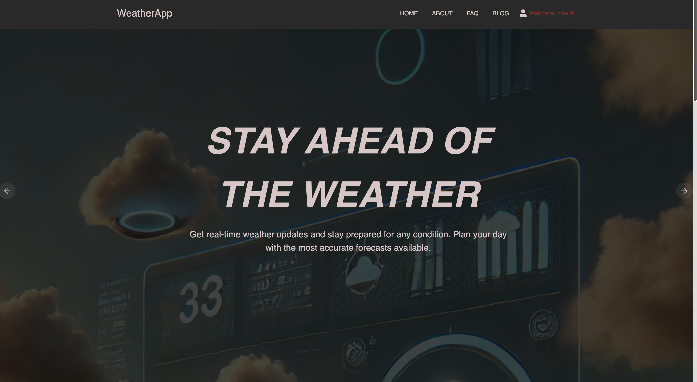
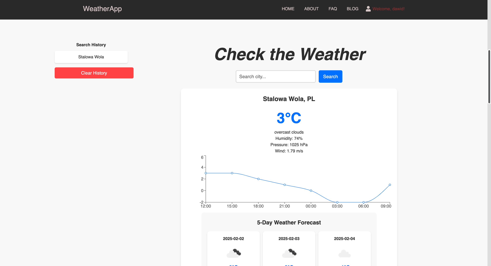
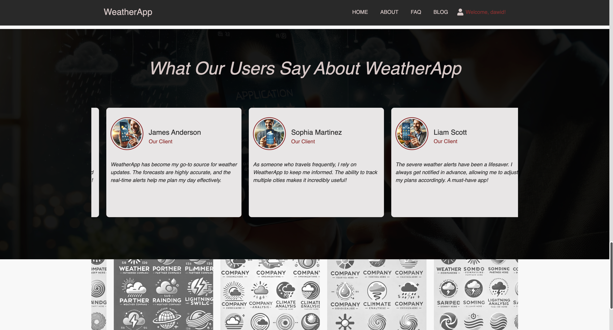
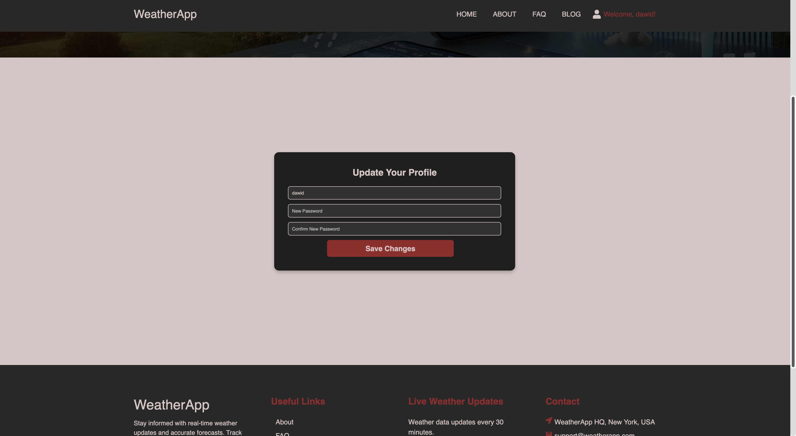
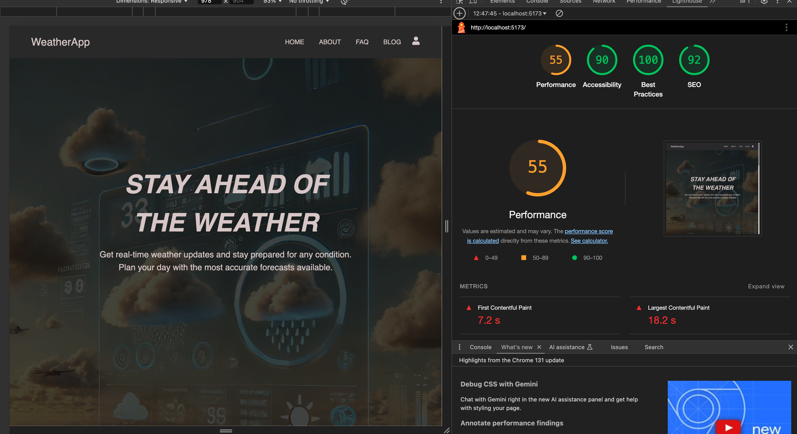
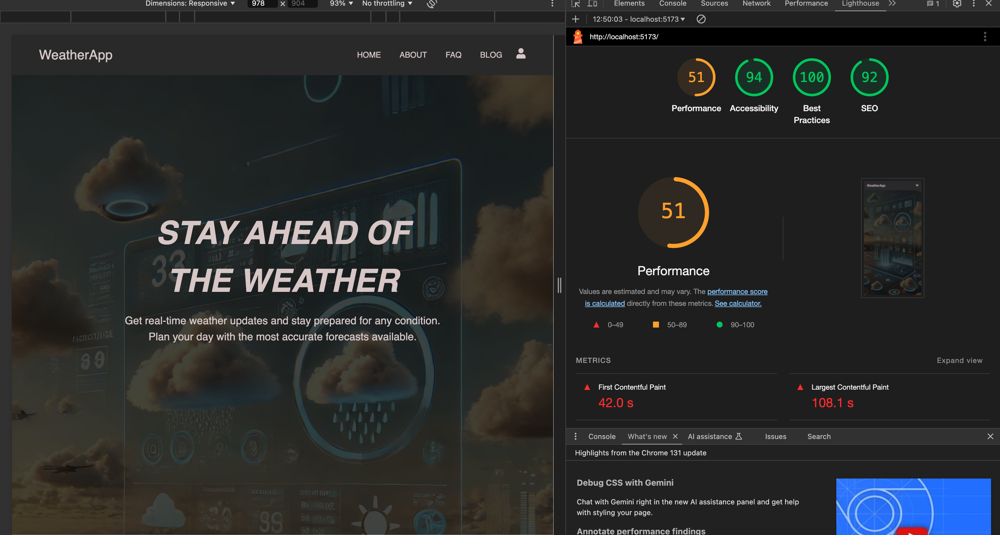

# Weather App

> 🌦️ **Weather that remembers** — a Laravel API and a React front end that keep the readings instead of throwing them away

**Weather App** shows the current weather for Polish cities and keeps every reading it fetches. A logged-in user builds their own list of cities; the backend asks OpenWeatherMap for the conditions, writes the answer into the database and serves the history back, so each city has a chart of where the temperature has actually been — not just where it is right now.

The two halves run separately: Laravel 11 exposes a JSON API secured with Sanctum, React 18 talks to it over Axios. The database is the point of the project — without it the app would be a thin proxy in front of somebody else's API.


---

## 🎯 Key Features

- **Readings are kept, not discarded** — every fetch lands in `weather_data`, so a city has a history and the front end can draw it with Recharts rather than showing one number.
- **Your own list of cities** — a logged-in user adds and removes cities; the list lives against the account, not in the browser, so it survives a change of device.
- **Search any city in the world** — `/api/weather?q=` passes the query straight to OpenWeatherMap and reports honestly when the city is not there.
- **A five-day forecast beside the current reading** — a separate endpoint takes the coordinates returned by the search, so the page answers "what now" and "what next" without a second lookup.
- **Token authentication** — Laravel Sanctum issues the token, React stores it in a cookie and attaches it to every call; the protected routes sit behind `auth:sanctum`.
- **A front end that is a site, not a dashboard** — home, about, blog and FAQ, with scroll animations (Framer Motion, react-scrollama), a slider and an animated counter.
- **Forms that validate before they submit** — Formik with Yup schemas, with masks on the fields that need them.
- **Responsive and measured** — the layout works down to a phone, and Lighthouse results for desktop and mobile are in `docs/Screenshots`.

---

## 🖼️ Screenshots

| The home page                                        | Weather for a chosen city                                |
| ---------------------------------------------------- | -------------------------------------------------------- |
|  |  |

| History drawn as a chart                              | The account area                                        |
| ----------------------------------------------------- | ------------------------------------------------------- |
|  |  |

| Lighthouse, desktop                                    | Lighthouse, mobile                                       |
| ------------------------------------------------------ | -------------------------------------------------------- |
|  |  |

---

## 🧩 How It Is Put Together

The backend keeps three tables of its own: `cities` (what can be tracked), `user_cities` (who tracks what) and `weather_data` (every reading ever fetched). A request for a city's history reads the third one; a request for current conditions calls OpenWeatherMap and writes the answer into it on the way back.

That is the whole idea of the project. The API key never reaches the browser — React talks only to Laravel, Laravel talks to OpenWeatherMap — which also means the key cannot be read out of the front-end bundle.

### API endpoints

| Method | Path                       | Guard   | Purpose                                  |
| ------ | -------------------------- | ------- | ---------------------------------------- |
| `POST` | `/api/register`            | —       | Create an account.                       |
| `POST` | `/api/login`               | —       | Issue a Sanctum token.                   |
| `POST` | `/api/logout`              | sanctum | Revoke the current token.                |
| `POST` | `/api/user/update`         | sanctum | Change the account details.              |
| `GET`  | `/api/user/cities`         | sanctum | The cities this user tracks.             |
| `POST` | `/api/user/add-city`       | sanctum | Start tracking a city.                   |
| `POST` | `/api/user/remove-city`    | sanctum | Stop tracking it.                        |
| `GET`  | `/api/user/update-weather` | sanctum | Refresh the readings for tracked cities. |
| `GET`  | `/api/city-history/{id}`   | sanctum | Stored readings for one city.            |
| `GET`  | `/api/weather?q=`          | —       | Current conditions for a city name.      |
| `GET`  | `/api/weather/forecast`    | —       | Five-day forecast for `lat` and `lon`.   |

---

## 🛠️ Technology Stack

### Backend

| Technology           | Version | Role                                                              |
| -------------------- | ------- | ----------------------------------------------------------------- |
| **Laravel**          | 11      | API, Eloquent models, migrations.                                 |
| **PHP**              | 8.2     | Runtime.                                                          |
| **Laravel Sanctum**  | 4       | Token authentication for the SPA.                                 |
| **MySQL**            | 8       | Cities, subscriptions and the reading history.                    |
| **OpenWeatherMap**   | 2.5     | Source of current conditions and the forecast.                    |

### Frontend

| Technology         | Version | Role                                                         |
| ------------------ | ------- | ------------------------------------------------------------ |
| **React**          | 18      | Component model and routing (`react-router-dom` 7).          |
| **Vite**           | 5       | Dev server and build.                                        |
| **Sass**           | 1.83    | Styles, organised per component.                             |
| **Axios**          | 1.7     | API calls, with the token attached.                          |
| **Recharts**       | 2.15    | Charts of stored readings.                                   |
| **Framer Motion**  | 12      | Page transitions and scroll animations.                      |
| **Formik + Yup**   | 2 / 1   | Forms and validation schemas.                                |

---

## 🚀 Getting Started

### Prerequisites

- PHP 8.2 or newer with Composer
- Node.js 18 or newer with npm
- MySQL 8 (or MariaDB)
- An OpenWeatherMap API key — the free tier is enough

### 1. Clone the repository

```bash
git clone https://github.com/dawidolko/Weather-App-Laravel-React.git
cd Weather-App-Laravel-React
```

### 2. Backend

```bash
cd backend
composer install
cp .env.example .env
php artisan key:generate
```

Set the database and the API key in `.env`:

```env
DB_DATABASE=weather_app
DB_USERNAME=root
DB_PASSWORD=

OPENWEATHER_API_KEY=your_key_here
```

Then create the schema and start the API:

```bash
php artisan migrate --seed
php artisan serve          # http://127.0.0.1:8000
```

### 3. Frontend

```bash
cd ../frontend
npm install
npm run dev                # http://localhost:5173
```

The front end calls `http://127.0.0.1:8000/api` directly, so the backend has to be running on that address. Serving it elsewhere means changing the base URL in `src/Context/AuthContext.jsx` and the components under `src/components/Product/`.

### 4. Keeping the readings fresh

The history grows whenever a reading is fetched. `GET /api/user/update-weather` refreshes every city the signed-in user tracks and writes the results into `weather_data`; calling it on a schedule (cron, a queued job) is what turns the table into a real archive.

---

## 📁 Project Structure

```
Weather-App-Laravel-React/
├── backend/                        # Laravel 11 API
│   ├── app/
│   │   ├── Http/Controllers/
│   │   │   ├── AuthController.php      # register, login, logout, profile
│   │   │   ├── UserCityController.php  # tracked cities and their history
│   │   │   └── WeatherController.php   # OpenWeatherMap: current and forecast
│   │   └── Models/
│   │       ├── City.php
│   │       ├── WeatherData.php         # one stored reading
│   │       └── User.php
│   ├── database/migrations/            # users, cities, user_cities, weather_data
│   └── routes/api.php                  # the table above
├── frontend/                       # React 18 + Vite
│   └── src/
│       ├── components/                 # Navbar, Hero, Map, Counter, Footer…
│       ├── pages/                      # Home, About, Blog, Faq, Auth
│       ├── Context/                    # session and API state
│       └── global.scss                 # shared styles
├── database/                       # SQL dump for a quick import
└── docs/                           # documentation and screenshots
```

---

## 📄 License

MIT © [Dawid Olko](https://dawidolko.pl)
